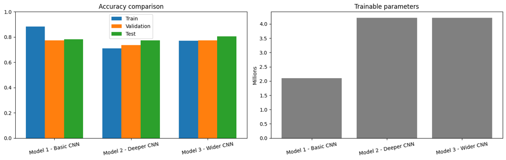
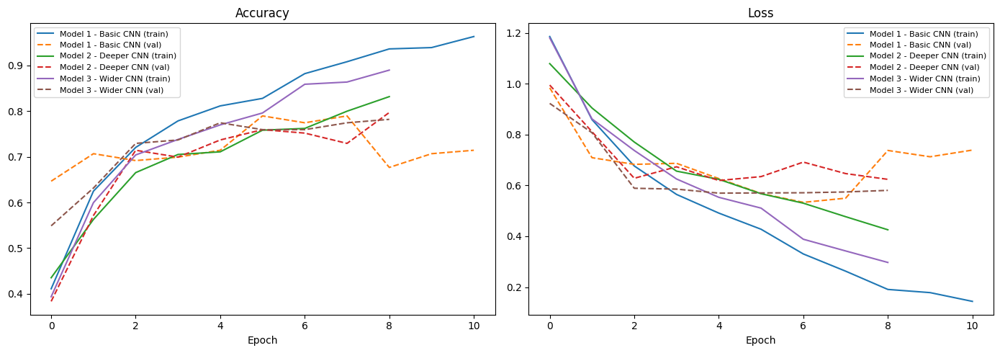
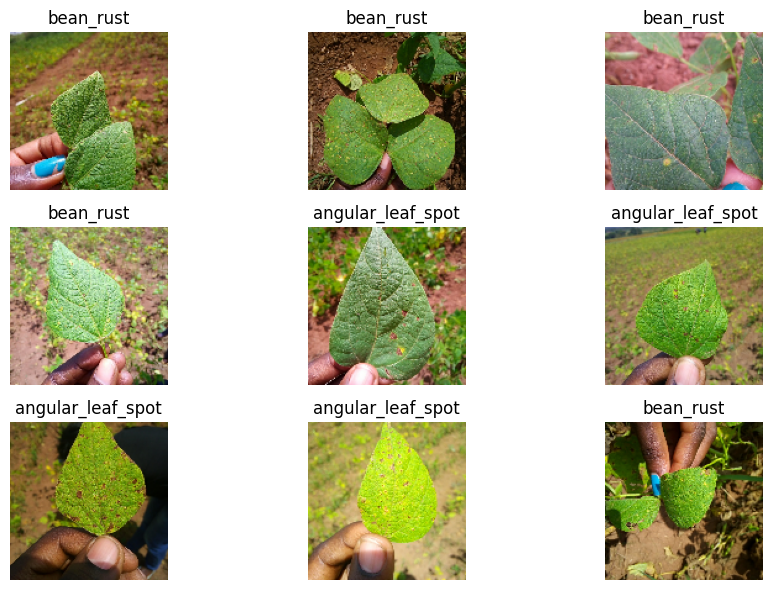
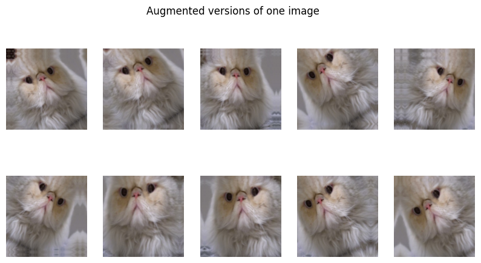

# Deep Learning for Computer Vision


Image classification and object detection with deep learning: CNNs designed from scratch, transfer learning and fine-tuning of ImageNet models, and custom object detection with YOLO. Built with TensorFlow/Keras and Ultralytics in Google Colab.

Coursework for Computer Vision, BSCS at Air University (Kharian Campus), Fall 2026.

> Classical OpenCV work (filtering, Hough, SIFT, stereo, optical flow) is in the companion repo: [classical-computer-vision-opencv](https://github.com/sarim0704/cv).

## Projects

| # | Project | Dataset | Approach | Result |
|---|---------|---------|----------|--------|
| 01 | [CNN architecture comparison](01-cnn-architecture-comparison/lab-task-7-cnn-comparison-ibeans.ipynb) | iBeans: bean leaf disease, 3 classes | Basic, deeper and wider CNNs trained from scratch on the same data | Test accuracy: Basic 78.1%, Deeper 77.3%, **Wider 80.5%** |
| 02 | [Transfer learning with DenseNet121](02-transfer-learning-densenet121/lab-8-transfer-learning-densenet121.ipynb) | Oxford-IIIT Pets: 12 cat breeds | Frozen DenseNet121 feature extractor, then fine-tuning the last layers with `ImageDataGenerator` augmentation | **85.0%** test accuracy |
| 03 | [Fine-tuning pretrained CNNs](03-fine-tuning-pretrained-cnns/assignment-3-fine-tuning-cnns-cats-vs-dogs.ipynb) | Microsoft Cats vs Dogs, about 25k images | VGG16, ResNet50, MobileNetV2 and EfficientNetB0 compared with data augmentation and a staged fine-tuning strategy | Accuracy, precision, recall and AUC comparison |
| 04 | [Custom object detection with YOLO](04-object-detection-yolo/lab-task-9-yolo-fine-tuning.ipynb) | Medical Pills (Ultralytics), 1 class | Fine-tuning YOLO11n on a class that is not in COCO, then validating and predicting on test images | mAP evaluation with Ultralytics |

## Results

### CNN comparison on iBeans



The wider network gave the best test accuracy. The deeper network had about twice the parameters of the basic one without improving on it.

### Sample data and augmentation
<p>
  
  
</p>

## Getting started

Open any notebook on GitHub and click **Open in Colab**. Use a GPU runtime (*Runtime → Change runtime type → T4 GPU*). The notebooks download their datasets automatically, except the DenseNet121 notebook, which reads the Oxford Pets cat images from Google Drive.

To run locally:

```bash
git clone https://github.com/sarim0704/cv2.git
cd cv2
pip install -r requirements.txt
jupyter notebook
```

## Repository structure

```
├── 01-cnn-architecture-comparison/
├── 02-transfer-learning-densenet121/
├── 03-fine-tuning-pretrained-cnns/
├── 04-object-detection-yolo/
├── assets/            # result images used in this README
└── requirements.txt
```

## Author

**Sarim Azhar**, BSCS student at Air University, interested in AI/ML and full stack development.
